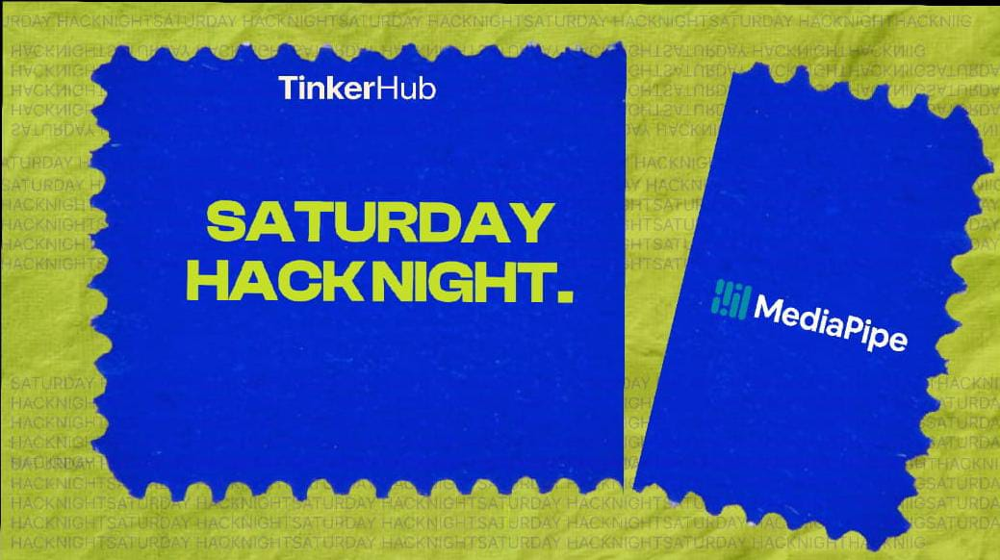

# SHN-MEDIAPIPE

🍳 GestureChef – Touchless Cooking Experience.

### 💡 What's the idea?
GestureChef is a touchless cooking assistant that allows users to navigate recipe instructions using simple hand gestures. It uses a webcam and MediaPipe Hands to recognize gestures, making cooking easier and more convenient without touching your device.

### 🌐 Check it out!
- **Live Website:** https://jenifferjerald2006-alt.github.io/SHN-MEDIAPIPE/
- **GitHub Repo:** https://github.com/jenifferjerald2006-alt/SHN-MEDIAPIPE.git

### 🛠️ What did you use?
- HTML5
- CSS3
- JavaScript
- MediaPipe Hands
- Webcam API

### 👥 The Humans Behind It
- Jeniffer Jerald J N – [@jenifferjerald2006-alt](https://github.com/jenifferjerald2006-alt)

### ⚙️ Hardware Corner
- Laptop/Desktop
- Built-in or external webcam

### 📸 Show Us What You Built!
https://drive.google.com/drive/folders/1-N9S2i3DtQ5GeT6fRVCmRF82Ywyv6Dt-

### ✨ Cool Things It Does
- ✋ Open Palm: Resume cooking instructions.
- ✊ Closed Fist: Pause cooking instructions.
- 👋 Hand Gestures: Navigate through recipe steps.
- 📋 Step-by-Step Instructions: Follow recipes easily.
- 📷 Real-Time Hand Tracking: Detect hand movements using MediaPipe Hands.

**Built with curiosity at Saturday Hack Night 💜**# 🚀 [🍳 GestureChef – Touchless Cooking Experience]
